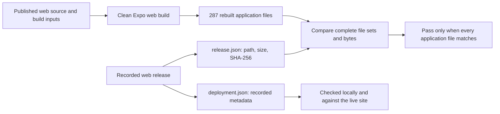
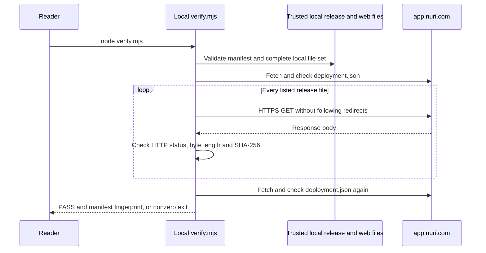
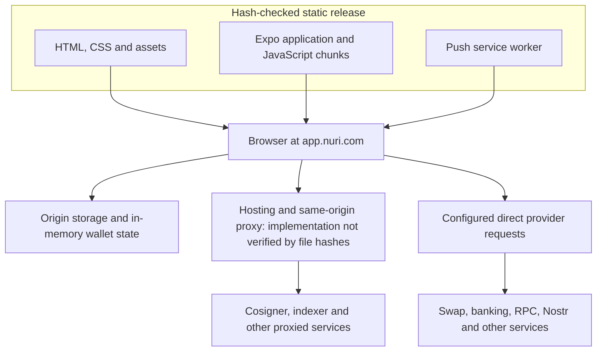
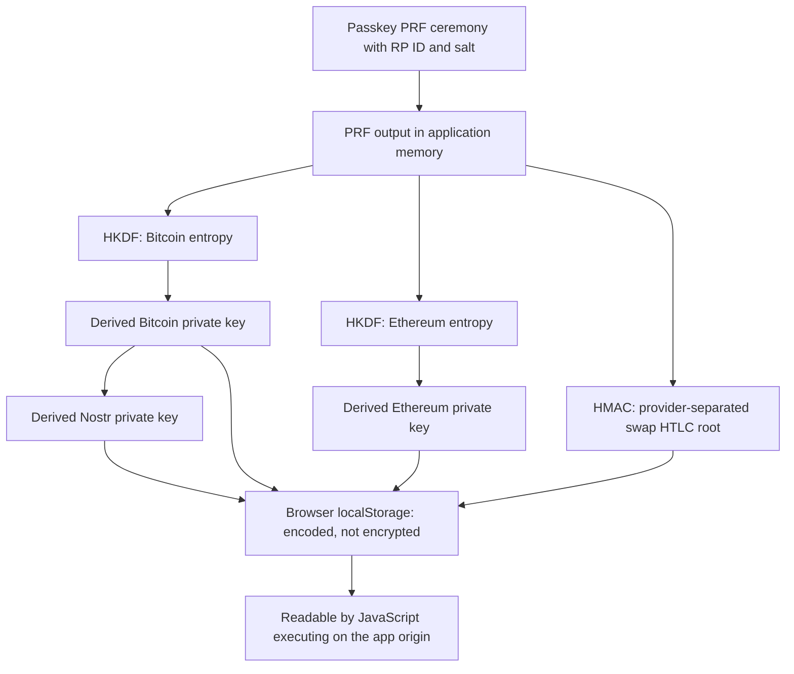

# Nuri Web — verify what app.nuri.com serves

This repository contains a **specific web release and the source needed to rebuild it**.
It is not the development repository, a demo, or a copy of the native applications.

**Result for this snapshot:** all **288 release files** matched the live site when
checked on **2026-09-29**. Building the reduced web source reproduced all **287
application files byte for byte**. The remaining file is deployment metadata.

**Security status:** matching bytes does not mean safe code. The web client persists
private keys in unencrypted browser storage. The repository also still has an
unreviewed earlier import in its Git history. See [security and publication](#security-and-publication)
before using a funded wallet or making this preparation repository public.

## Contents

- [Check the live app](#check-the-live-app)
- [Which hash identifies the release?](#which-hash-identifies-the-release)
- [Rebuild the application](#rebuild-the-application)
- [How verification works](#how-verification-works)
- [Application architecture and data boundaries](#application-architecture-and-data-boundaries)
- [Passkeys, wallet keys and storage](#passkeys-wallet-keys-and-storage)
- [Security and publication](#security-and-publication)
- [Updates and verification limits](#updates-and-verification-limits)

## Check the live app

Use Node.js 22. Obtain this repository from a revision you trust, inspect the small
[checker](verify.mjs), and run it from the repository root:

```sh
git clone https://github.com/nuri-com/nuri-wallet.git
cd nuri-wallet
node verify.mjs
```

The checker uses only Node.js built-ins: no dependency installation, browser wallet,
login, private key or production account is needed. It reads the local release
manifest, checks the local files, then fetches the listed files from
`https://app.nuri.com` and compares their bytes. It does not execute downloaded
JavaScript, connect a wallet, sign transactions or deploy anything.

For this snapshot, success prints:

```text
PASS: 288 live files match release 746be77ad6c0b4599835262a3c36a48779b0e7c2
Release manifest SHA-256: 3f5615fd3fcc3b48edef6ed515ac65d820e85f762825c7c6f2c6bbc23b023f00
```

A failed request or mismatch produces a nonzero exit status. It is not proof of an
attack: a newer legitimate deployment, network failure or incomplete rollout can
also cause failure. Do not bypass the failure by replacing the reference with files
freshly downloaded from the same server. First identify the intended release.

### What is in this repository?

| Path | Purpose |
| --- | --- |
| [`web/`](web/) | The exact static release: HTML, CSS, JavaScript, fonts, images, service worker and metadata. |
| [`source/`](source/) | The production web graph's source, static web configuration, lockfile, package patches and necessary build/safety checks. |
| [`release.json`](release.json) | Every release path with its byte length and SHA-256, plus the original source identifier. |
| [`verify.mjs`](verify.mjs) | The independent local, live and rebuild checker. |
| [`verify.test.mjs`](verify.test.mjs) | Offline regression checks for mismatches, path validation, redirects, changing deployments and the preserved cosigner boundary. |

The release contains **240 Expo JavaScript chunks**, two other JavaScript files
(the service worker and QR library), HTML, CSS, assets and three JSON files.
The full inventory is **288 files / 26,737,527 bytes**. Checking only the main
JavaScript file would leave other executable code and resources unchecked.

The source subset was selected from Metro's emitted module graph, not by guessing
which filenames looked unused. Its **603 emitted project source/asset files** were
preserved byte for byte; necessary build inputs are included as well. Shared code
or a runtime debug helper can remain if it is part of that graph. Operational tools,
plan archives, native projects and deployment workflows are not in the current tree.
Dependency declarations and the lockfile are retained rather than pruned in a way
that could change package resolution and the resulting bytes.

## Which hash identifies the release?

There are three distinct identifiers:

| Identifier | Meaning |
| --- | --- |
| A Git commit | A particular source-tree/history identity. The upstream deployment commit and this repository's commit are not interchangeable. |
| A file's SHA-256 | The exact bytes of one HTML, JavaScript, image or other file. Filename hashes are not a substitute for this check. |
| The SHA-256 of `release.json` | A fingerprint of the entire recorded inventory: paths, sizes, file hashes and source label. It is not the hash of one concatenated application file. |

**Release manifest SHA-256:**

```text
3f5615fd3fcc3b48edef6ed515ac65d820e85f762825c7c6f2c6bbc23b023f00
```

Compute it independently with Node.js:

```sh
node -e 'const fs=require("node:fs"),crypto=require("node:crypto"); console.log(crypto.createHash("sha256").update(fs.readFileSync("release.json")).digest("hex"))'
```

The main application bundle is
[`index-aa0c395b1e97a9a6fb9af9040d4bc72a.js`](web/_expo/static/js/web/index-aa0c395b1e97a9a6fb9af9040d4bc72a.js).
Its SHA-256 is:

```text
705b03e3e202d06ac76c00df5ac64e6b379380ab4081abf8f5ab49b0b27463d7
```

A hash is not a signature or an endorsement. An attacker who replaces the manifest,
checker and reference hash can make malicious files agree with that replacement.
The trust anchor must be a separately authenticated repository revision or release
reference, not a manifest obtained only from the site under inspection. This snapshot
does not provide a signed build attestation. The manifest's `source_sha` is a label;
actual rebuilding supplies the byte-correspondence evidence. The manifest fingerprint
does not hash `source/`, `verify.mjs` or this README: authenticate their repository
revision separately. Documentation changes do not change the web-release fingerprint.

## Rebuild the application

Use a clean checkout and an environment without production credentials, wallet
stores or local `.env` overrides. Review dependencies and install hooks first:
`npm ci` executes the package's `patch-package` postinstall hook and dependency hooks.
Rebuilding is different from the dependency-free checker.

```sh
cd source
npm ci --legacy-peer-deps
npm run build
cd ..
node verify.mjs rebuild
```

The build writes `source/dist/`. It does not change `web/` or publish a release.
The checker compares every rebuilt application file against the checked-in manifest,
rejecting missing, extra or changed files.



### Why 287 rebuilt files but 288 release files?

`web/deployment.json` records deployment-time information, including the source SHA,
release ID and timestamp. Expo does not produce that file. Rebuild mode excludes
**only that named file** from the expected build output; it does not silently
ignore arbitrary differences. Local and live verification still check the deployment
file's full bytes against the manifest.

The evaluated web configuration is in [`source/app.json`](source/app.json). Native
platform configuration and native plugins were removed from the source export;
the resulting application bytes were then checked, not assumed to be unchanged.

| Recorded evidence | Value |
| --- | --- |
| Application version | `0.100.0` |
| Deployment ID | `pwa-746be77ad6c0` |
| Original deployment source | `746be77ad6c0b4599835262a3c36a48779b0e7c2` |
| Deployment timestamp | `2026-09-29T04:05:14Z` |
| Last complete live comparison for this snapshot | `2026-09-29` |
| Rebuild environment | Node `22.22.3`, npm `10.9.4`, two separate clean directories |
| Original production CI | Node `22.23.2`, npm `10.9.8` |
| Rebuild result | All 287 application files byte-identical |

This is observed reproduction for these inputs/environments, not a claim that every
future operating system, toolchain or environment override will produce identical
bytes. The source identifier above is not this repository's Git commit.

## How verification works



- **Local:** `node verify.mjs local` checks `web/` without contacting the app. Extra,
  missing or modified files fail. Symlinks and invalid/duplicate manifest paths fail.
- **Live:** `node verify.mjs` first performs the local check, then checks the listed
  HTTPS responses. Each request has a 15-second timeout. Oversized responses,
  unexpected status codes, redirects and wrong hashes fail.
- **Rebuild:** `node verify.mjs rebuild` checks the recorded local release and compares
  `source/dist/` with its application-file subset, treating deployment metadata separately.

The HTML entry in the manifest is `index.html`, but the request is made to `/`:
Cloudflare redirects `/index.html` there. The checker hashes the actual homepage,
not a redirect response. HTTP compression is decoded before hashing, so gzip or
Brotli transport encoding does not change the expected application bytes.

Deployment metadata is checked before and after the file pass as well as within
the inventory. A change from the pinned metadata fails verification. This detects
ordinary deployment changes during the check; it cannot force a hostile server to
serve consistent responses to everyone. HTTP also provides no exhaustive listing
of unknown routes, so the live check cannot reject every unlisted resource a server
might additionally expose. The local file-set check can reject extras on disk.

Run the offline tests with:

```sh
node --test verify.test.mjs
```

There are 11 regression tests, including a check that the cosigner guard scans the
nested `source/` directory instead of accidentally checking an empty repository root.
For the build safety checks, after installing dependencies:

```sh
cd source
npm run check
```

## Application architecture and data boundaries



This diagram describes trust boundaries, not an exhaustive packet capture. Some
requests are proxied and others go directly to configured services. The server-side
implementations and their retention policies are outside this source snapshot.

| Flow | Inspectable entrypoints | What the boundary means |
| --- | --- | --- |
| Application startup and UI | [`index.js`](source/index.js), [`App.tsx`](source/App.tsx), [`screens/`](source/screens/) | Platform adapters, state and background work affect the application, not only the visible screen. |
| Web module resolution | [`metro.config.js`](source/metro.config.js), [`lib/web/`](source/lib/web/) | Browser adapters differ from native implementations. A native-looking API name is not evidence of hardware key protection. |
| Bitcoin/Arkade signing | [`services/arkade/`](source/services/arkade/), [`config/endpoints.ts`](source/config/endpoints.ts) | The current client uses `arkade.nuri.com` v4. Remote signing policy and service availability require separate evidence. |
| EVM transfers | [`BaseTokenTransferService.ts`](source/services/base/BaseTokenTransferService.ts), [`SwapKitEvmSigner.ts`](source/services/swapkit/SwapKitEvmSigner.ts) | Local Ethereum key material becomes an EVM signer. Bitcoin cosigning does not apply to every asset or execution path. |
| Swaps | [`SwapKitV2CommitFlow.ts`](source/services/swapkit/SwapKitV2CommitFlow.ts), [`SwapKitV2ActionService.ts`](source/services/swapkit/SwapKitV2ActionService.ts) | Quotes, validation, persisted recovery state and wallet executors must be inspected together. File integrity does not guarantee liquidity, fair prices or successful recovery. |
| RPC and provider requests | [`config/network.ts`](source/config/network.ts), [`services/wirex/`](source/services/wirex/) | Addresses, amounts, transaction requests and provider account data can be visible to their recipients. |
| Support and diagnostics | [`SupportDumpService.ts`](source/services/support/SupportDumpService.ts), [`DebugLogBuffer.ts`](source/services/logging/DebugLogBuffer.ts) | Reports include diagnostics and wallet-related metadata. Personal-data inclusion is separately gated in the service. Reports are encrypted for support, but support can read them. A full caller/redaction/retention audit is still needed. |

Onchain transactions are public. RPCs, hosting, banking, swap and messaging services
can observe the data their requests carry and associated network metadata. This
repository is not evidence of those operators' logging or deletion practices.
An allowed host in the [Content Security Policy](source/public/index.html) is not
proof that a request occurred or proof of its payload.

## Passkeys, wallet keys and storage

A passkey's credential key and the wallet keys derived by this app are **not the
same thing**. The WebAuthn PRF result is available to application code during
wallet derivation. That does not mean the authenticator's credential private key
is exported; it means the derived wallet material has its own storage boundary.



Evidence: [web passkey ceremonies](source/services/auth/PasskeyNativeModuleService.web.ts),
[wallet bootstrap](source/services/auth/PasskeyPrfWalletBootstrapService.ts),
[derivation functions](source/lib/walletDerivation.ts), and
[web key storage](source/lib/secureKeyStorage.web.ts).

Derivation is domain-separated, but the keys are not independent of their parent
material. Compromise of the PRF root has broader consequences than compromise of
one derived key; the Bitcoin key is also an input to Nostr derivation. Correct RP ID,
credential, salt and derivation context matter for recovery. These public constants
are not passwords and must not be changed merely to make the code look sanitized.
A different hosting origin cannot simply reuse production passkeys.

The storage adapter uses `nuri.sks.` localStorage entries and base64url for private
keys and HTLC roots. Base64url is reversible encoding, **not encryption**. Some web
lock/cache methods are no-ops. The [web keychain adapter](source/lib/web/ReactNativeKeychainWeb.ts)
also uses localStorage; it does not inherit native keychain/biometric guarantees.

## Security and publication

### Assessment: do not treat this as cleared for public release

Open source is not the cause of the main wallet weakness below. Browser code and
client configuration are already delivered to visitors, and publishing readable
source makes existing behavior easier to audit. It can also make weaknesses easier
to find. Keeping the source private is not a remedy for insecure key handling.

This is a **scoped source and publication review**, not a penetration test, a
complete transaction-policy audit, or confirmation that every dependency is safe.
No funded wallet, real private key or provider credential was used to test an exploit.

### High: persisted web keys are readable by same-origin JavaScript

**Confirmed implementation behavior.** [`storePrivateKey`](source/lib/secureKeyStorage.web.ts#L155-L159)
stores encoded private keys in localStorage; [`getPrivateKey`](source/lib/secureKeyStorage.web.ts#L162-L179)
decodes them. Nostr keys and swap roots have
similar persistence. This remains true after the application has initially obtained
the material through a passkey ceremony.

If an attacker obtains script execution on that origin, compromises delivered
application code, or gains relevant browser-profile access, this storage does not
provide cryptographic confidentiality. An operator who controls delivered JavaScript
can also change what that JavaScript reads. This review does **not** demonstrate an
unauthenticated remote XSS exploit or claim that an ordinary unrelated website can
read another origin's localStorage.

The EVM impact is concrete: `loadBaseAccount` in
[BaseTokenTransferService.ts](source/services/base/BaseTokenTransferService.ts#L69-L77) loads
the Ethereum private key and constructs a `privateKeyToAccount` signer for token
transfers. A Bitcoin cosigner is not an additional signer on that EOA path. Bitcoin
and swap paths need their own protocol-specific review; do not infer that stealing
one client share necessarily defeats every cosigned transaction.

**Required engineering response:** review the web signing/key-storage model before
representing it as protected by passkeys or biometrics. Simply changing localStorage
to IndexedDB, or encrypting with a key stored beside the ciphertext, does not solve
same-origin script access. Encryption with separately protected unlock material can
reduce at-rest exposure, but a malicious frontend while unlocked remains a distinct
threat. Stronger signer isolation and transaction-bound authorization require their
own design, compatibility and recovery tests. No such remediation is claimed here.

### Publication blocker: the old import remains in Git history

The current tree is minimal. The repository's initial commit is not: it still
contains superseded development documentation, plan archives and fixtures. Removing
files from the default branch does not remove their earlier versions. Making the
repository public exposes reachable history as well as the README people see first.

Publish a reviewed clean history, or complete an authorized history cleanup before
changing visibility. Removing history is not credential revocation and cannot undo
copies already made. No history rewrite or visibility change is performed by the
verification commands.

### Review required: browser API keys and third-party configuration

The source contains a shared Alchemy client key, and the shipped dependencies
contain other client configuration, including provider/analytics keys. Such values
must be assumed observable by anyone receiving the app; hiding the source does not
protect them. They are not automatically equivalent to a server administrator key.

Provider-side origin/API restrictions, quotas and billing controls have **not** been
verified. Assess each key's intended public use and permissions; restrict or replace
inappropriate credentials through the provider and a new app release. Do not remove
values from this snapshot while claiming its bytes still match production.

### Scan evidence and its limits

Gitleaks **8.30.1**, using built-in rules, full output redaction and no finding
suppressions, reported:

| Scope | Raw findings | Interpretation |
| --- | --- | --- |
| Current tracked web snapshot | 19 | Client configuration plus matches in translations, identifiers and minified library code. Not 19 confirmed secret leaks. |
| Reachable repository history at this review | 36 across two commits | Includes the earlier Firebase configuration, fixtures and repeated/moved content. Not 36 distinct credentials. |

No wallet seed or server private key was confirmed in the inspected findings.
This is not proof that none exists anywhere in the repository, history or services.
Pattern scans do not establish provider permissions, anonymize financial records,
or replace manual privacy and dependency review. Raw values and scan reports are
not published in this README.

### Licensing is a separate publication gate

Application source is under [MIT](LICENSE). Dependencies, bundled fonts and other
assets retain their own terms. The owner has confirmed redistribution rights for
Harriet and Sharp Grotesk, but the applicable notices still need to be supplied and
reviewed. Source licensing does not automatically relicense all bundled material.

This preparation repository remains private, with GitHub Actions disabled. Keep
production credentials, wallet data, support exports and identity documents out of
public issues and commits. The client-side storage problem is not fixed by making
the repository public, nor by passing the hash checker.

## Updates and verification limits

This is a pinned snapshot, **not an automatically synchronized mirror**. A later
production deployment requires its own reviewed source and complete file inventory.
Do not silently replace release files under an existing trusted identity. Publishing
or editing this repository does not deploy the application or issue an OTA update.

A successful check establishes byte correspondence for the responses it obtained.
It does not establish any of the following:

1. An already-open tab or installed PWA is executing those same bytes. Its loaded
   code, cache or service-worker state can differ from a new request.
2. Other users receive the same responses. A server can vary delivery by session,
   region, timing or another request attribute.
3. Backend/edge implementations, API results, response-header settings or account
   policies correspond to published source. Those are separate trust boundaries.
4. Every possible route, external script, embedded provider or data response has
   been enumerated. This inventory covers the recorded static application files.
5. The matching application is secure, bug-free, private or guaranteed to recover
   funds. Reproducibility and code safety are different claims.

Use the checker for its specific evidence: **this reviewed source rebuilds the
recorded application files, and these fetched responses match that recorded release**.
Do not turn that statement into a broader security certification.
