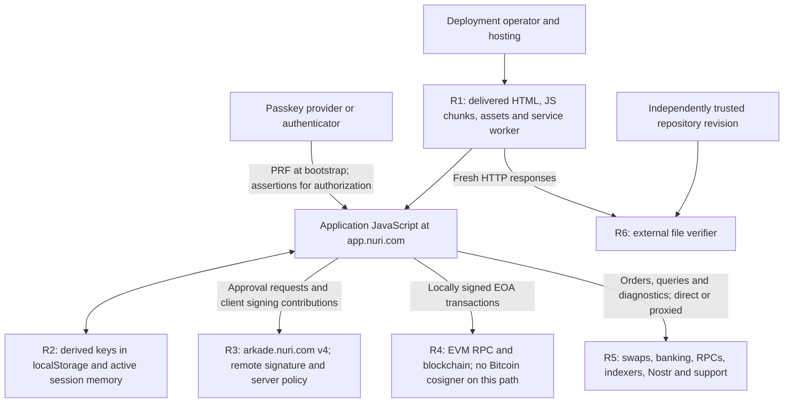
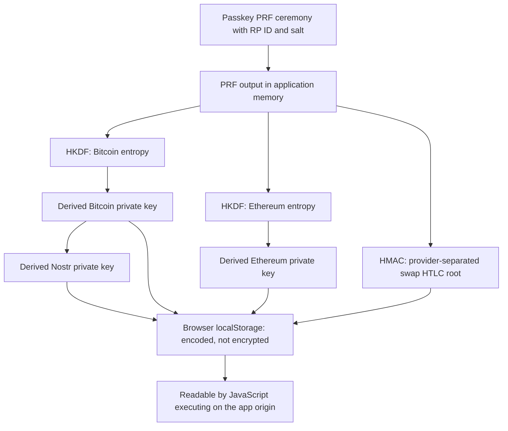
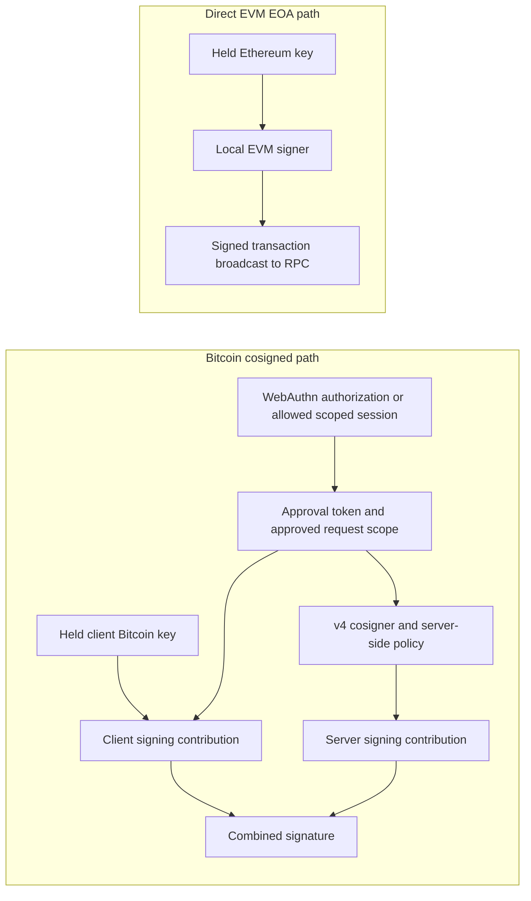

# Security and architecture review: release 0.100.0

This review was written by hand for release `pwa-746be77ad6c0` (source `746be77ad6c0b4599835262a3c36a48779b0e7c2`, deployed 2026-09-29). Its file links and line numbers refer to that release, not to the release currently in this repository. Later releases are published automatically and are not covered by it.

## Application architecture and data boundaries

This diagram describes trust boundaries, not an exhaustive packet capture. Some
requests are proxied and others go directly to configured services. The server-side
implementations and their retention policies are outside this source snapshot.

| Flow | Inspectable entrypoints | What the boundary means |
| --- | --- | --- |
| Application startup and UI | [`index.js`](https://github.com/nuri-com/nuri-wallet/blob/pwa-746be77ad6c0/source/index.js), [`App.tsx`](https://github.com/nuri-com/nuri-wallet/blob/pwa-746be77ad6c0/source/App.tsx), [`screens/`](https://github.com/nuri-com/nuri-wallet/blob/pwa-746be77ad6c0/source/screens/) | Platform adapters, state and background work affect the application, not only the visible screen. |
| Web module resolution | [`metro.config.js`](https://github.com/nuri-com/nuri-wallet/blob/pwa-746be77ad6c0/source/metro.config.js), [`lib/web/`](https://github.com/nuri-com/nuri-wallet/blob/pwa-746be77ad6c0/source/lib/web/) | Browser adapters differ from native implementations. A native-looking API name is not evidence of hardware key protection. |
| Bitcoin/Arkade signing | [`services/arkade/`](https://github.com/nuri-com/nuri-wallet/blob/pwa-746be77ad6c0/source/services/arkade/), [`config/endpoints.ts`](https://github.com/nuri-com/nuri-wallet/blob/pwa-746be77ad6c0/source/config/endpoints.ts) | The current client uses `arkade.nuri.com` v4. Remote signing policy and service availability require separate evidence. |
| EVM transfers | [`BaseTokenTransferService.ts`](https://github.com/nuri-com/nuri-wallet/blob/pwa-746be77ad6c0/source/services/base/BaseTokenTransferService.ts), [`SwapKitEvmSigner.ts`](https://github.com/nuri-com/nuri-wallet/blob/pwa-746be77ad6c0/source/services/swapkit/SwapKitEvmSigner.ts) | Local Ethereum key material becomes an EVM signer. Bitcoin cosigning does not apply to every asset or execution path. |
| Swaps | [`SwapKitV2CommitFlow.ts`](https://github.com/nuri-com/nuri-wallet/blob/pwa-746be77ad6c0/source/services/swapkit/SwapKitV2CommitFlow.ts), [`SwapKitV2ActionService.ts`](https://github.com/nuri-com/nuri-wallet/blob/pwa-746be77ad6c0/source/services/swapkit/SwapKitV2ActionService.ts) | Quotes, validation, persisted recovery state and wallet executors must be inspected together. File integrity does not guarantee liquidity, fair prices or successful recovery. |
| RPC and provider requests | [`config/network.ts`](https://github.com/nuri-com/nuri-wallet/blob/pwa-746be77ad6c0/source/config/network.ts), [`services/wirex/`](https://github.com/nuri-com/nuri-wallet/blob/pwa-746be77ad6c0/source/services/wirex/) | Addresses, amounts, transaction requests and provider account data can be visible to their recipients. |
| Support and diagnostics | [`SupportDumpService.ts`](https://github.com/nuri-com/nuri-wallet/blob/pwa-746be77ad6c0/source/services/support/SupportDumpService.ts), [`DebugLogBuffer.ts`](https://github.com/nuri-com/nuri-wallet/blob/pwa-746be77ad6c0/source/services/logging/DebugLogBuffer.ts) | Reports include diagnostics and wallet-related metadata. Personal-data inclusion is separately gated in the service. Reports are encrypted for support, but support can read them. A full caller/redaction/retention audit is still needed. |

Onchain transactions are public. RPCs, hosting, banking, swap and messaging services
can observe the data their requests carry and associated network metadata. This
repository is not evidence of those operators' logging or deletion practices.
An allowed host in the [Content Security Policy](https://github.com/nuri-com/nuri-wallet/blob/pwa-746be77ad6c0/source/public/index.html) is not
proof that a request occurred or proof of its payload.

## Passkeys, wallet keys and storage

A passkey's credential key and the wallet keys derived by this app are **not the
same thing**. The WebAuthn PRF result is available to application code during
wallet derivation. That does not mean the authenticator's credential private key
is exported; it means the derived wallet material has its own storage boundary.

Evidence: [web passkey ceremonies](https://github.com/nuri-com/nuri-wallet/blob/pwa-746be77ad6c0/source/services/auth/PasskeyNativeModuleService.web.ts),
[wallet bootstrap](https://github.com/nuri-com/nuri-wallet/blob/pwa-746be77ad6c0/source/services/auth/PasskeyPrfWalletBootstrapService.ts),
[derivation functions](https://github.com/nuri-com/nuri-wallet/blob/pwa-746be77ad6c0/source/lib/walletDerivation.ts), and
[web key storage](https://github.com/nuri-com/nuri-wallet/blob/pwa-746be77ad6c0/source/lib/secureKeyStorage.web.ts).

Derivation is domain-separated, but the keys are not independent of their parent
material. Compromise of the PRF root has broader consequences than compromise of
one derived key; the Bitcoin key is also an input to Nostr derivation. Correct RP ID,
credential, salt and derivation context matter for recovery. These public constants
are not passwords and must not be changed merely to make the code look sanitized.
A different hosting origin cannot simply reuse production passkeys.

The storage adapter uses `nuri.sks.` localStorage entries and base64url for private
keys and HTLC roots. Base64url is reversible encoding, **not encryption**. Some web
lock/cache methods are no-ops. The [web keychain adapter](https://github.com/nuri-com/nuri-wallet/blob/pwa-746be77ad6c0/source/lib/web/ReactNativeKeychainWeb.ts)
also uses localStorage; it does not inherit native keychain/biometric guarantees.
The storage adapter also persists authentication-related state through `storeAuthData`
and `storeAuthKey`. Its exposure boundary is therefore not limited to coin keys;
the permissions and lifetime of each credential depend on its protocol and backend.

### Intended lifecycle: derive once, retain keys, authorize signing separately

The [storage implementation's own comments](https://github.com/nuri-com/nuri-wallet/blob/pwa-746be77ad6c0/source/lib/secureKeyStorage.web.ts#L1-L14)
explicitly describe this persistence decision and cite the cosigner as the second
factor. This is not an accidental fallback to plaintext storage. The important
question is which signing paths actually have that second factor.

For the current Bitcoin/Arkade client,
[`SigningKeyVault`](https://github.com/nuri-com/nuri-wallet/blob/pwa-746be77ad6c0/source/services/arkade/internal/signingKeyVault.ts#L224-L305)
distinguishes two operations:

1. **Bootstrap/recovery:** a PRF ceremony derives wallet material, which is persisted.
2. **Signing authorization:** a standard WebAuthn assertion is obtained when required,
   and the held Bitcoin key is loaded. The code explicitly does not request the PRF
   again for that assertion. It checks that the held key matches the expected public key.

Temporary signing-key copies are scoped and cleared when that operation ends. This
reduces the lifetime of those copies; it does not erase the persisted localStorage
entry or make JavaScript memory reliably inaccessible to a compromised runtime.

The client also supports scoped approval/session reuse for selected receive,
boarding and recovery operations. For example,
[`requestBoardingSweepApprovalToken`](https://github.com/nuri-com/nuri-wallet/blob/pwa-746be77ad6c0/source/services/arkade/ArkadeRemoteIdentity.ts#L1451-L1545)
can request an approval using an existing session token without another assertion.
Consequently, this architecture must not be described as "a fresh biometric prompt
for every signature." Session scope, expiry and server enforcement matter.

### Two different signing boundaries

This diagram shows the client protocol, not an independent audit of the cosigner.
[`ArkadeRemoteIdentity`](https://github.com/nuri-com/nuri-wallet/blob/pwa-746be77ad6c0/source/services/arkade/ArkadeRemoteIdentity.ts#L2050-L2205)
requires an approval token in this signing path and obtains the server's signing
contribution. A copied client key alone is not equivalent to both cosigning keys.
The direct EVM path in
[`BaseTokenTransferService`](https://github.com/nuri-com/nuri-wallet/blob/pwa-746be77ad6c0/source/services/base/BaseTokenTransferService.ts#L69-L77)
constructs an EOA signer from the held Ethereum key and does not use that Bitcoin
cosigner. Smart accounts, HTLCs and other asset paths require their own policy analysis.

## Security and publication

### Known design, residual risk, and publication hygiene

Persistent browser-readable derived keys are **intended behavior in this snapshot**.
The source comments state that choice, and the signing code deliberately reuses
held key material after separate authorization. Documenting that decision is not a finding that storage
has unexpectedly malfunctioned. It also does not establish that every asset is
protected by a cosigner or that browser compromise is harmless.

Browser code and client configuration are already delivered to visitors. Publishing
readable source makes their behavior easier to inspect; it does not newly upload a
user's locally generated wallet keys. Known architectural trade-offs can be documented
honestly in an open-source release. They are separate from inadvertently publishing
private history, personal data or credentials that were never intended to be public.

This is a **scoped architecture and publication review**, not a penetration test, a
complete transaction-policy audit, or confirmation that every dependency is safe.
No funded wallet, real private key or provider credential was used to test an exploit.

### Risk map

The identifiers below correspond to the architecture diagram. The table separates
observed mechanisms from the assumptions needed for those mechanisms to protect users.

| Boundary | Intended protection / observed mechanism | Concrete residual risk and condition |
| --- | --- | --- |
| **R1: code delivery** | HTTPS and the browser origin load the app. The [CSP](https://github.com/nuri-com/nuri-wallet/blob/pwa-746be77ad6c0/source/public/index.html) restricts script sources; the independent checker compares received static bytes with a trusted release. | A compromised deployer, hosting account, allowed script or exploitable injection can change code executed on the wallet origin. Legitimate-origin malicious code can read its origin's storage. A hash check only detects changed bytes in the responses actually checked. |
| **R2: local key persistence** | [`secureKeyStorage.web.ts`](https://github.com/nuri-com/nuri-wallet/blob/pwa-746be77ad6c0/source/lib/secureKeyStorage.web.ts#L155-L179) intentionally retains derived keys. The browser's same-origin policy separates unrelated websites. | Same-origin script execution or access to relevant browser-profile data can expose persisted key material. Base64url does not encrypt it. Scoped zeroization does not remove the persistent entry. Nostr identity and swap roots have their own consequences if exposed. |
| **R3: Bitcoin/Arkade cosigning** | Client and server signing contributions, WebAuthn authorization and approval scopes form an additional boundary. See [`SigningKeyVault`](https://github.com/nuri-com/nuri-wallet/blob/pwa-746be77ad6c0/source/services/arkade/internal/signingKeyVault.ts) and [`ArkadeRemoteIdentity`](https://github.com/nuri-com/nuri-wallet/blob/pwa-746be77ad6c0/source/services/arkade/ArkadeRemoteIdentity.ts). | Client-key theft is not automatically theft of the server key. Protection still depends on server-side request binding, scope/expiry enforcement and the actual protocol. An active compromised browser may have session material or mislead a user into authorizing an action. This snapshot does not independently prove the server's policy or availability. |
| **R4: direct EVM EOA signing** | The local Ethereum key creates a signer in [`BaseTokenTransferService`](https://github.com/nuri-com/nuri-wallet/blob/pwa-746be77ad6c0/source/services/base/BaseTokenTransferService.ts#L69-L77); UI and client code validate the intended operation. | If that private key is stolen, an attacker can sign for the EOA outside the UI. A Bitcoin cosigner is not required on this path. Exposure of funds or allowances depends on that account's holdings and onchain permissions. This is a potentially high-impact browser-compromise consequence, not proof of an existing remote exploit. |
| **R5: providers and diagnostics** | HTTPS, protocol-specific validation and recipient encryption protect particular exchanges. Swap actions have client checks; support reports use encryption for support. | Providers still receive their intended addresses, orders, transactions or account data. Support can read reports encrypted to it. Provider outages, erroneous responses, counterparty/contract behavior, logging and privacy retention are not resolved by static-file hashes. |
| **R6: verification reference** | A separately trusted repository revision supplies the checker, source and manifest; rebuilding checks correspondence to the recorded files. | If the reference or verifier is replaced, internally matching hashes do not prove authenticity. A server can serve different code to another session, and an already-open tab may run older code. No independent backend attestation or universal-delivery proof is claimed. |

An unrelated website cannot normally read another origin's localStorage merely
because this source is public. The relevant conditions are origin/runtime compromise,
relevant device/profile access, or control of the delivered application. No working
XSS exploit or cosigner-policy bypass is demonstrated in this review.

A WebAuthn user-verification ceremony also is not, by itself, a trusted display of
the transaction's destination and amount. Transaction binding and what the user
actually approved must be assessed separately. Existing scoped sessions are part of
that assessment; they must not be described as unrestricted approvals or as a fresh
passkey prompt for each internal signature without inspecting the applicable policy.

**What is and is not changed here:** this repository documents the current model;
it does not silently replace it with another storage or signing architecture. Moving
keys to IndexedDB would not by itself create a new same-origin isolation boundary.
At-rest encryption and stronger signer isolation address different threats and would
require a separately reviewed release with recovery/compatibility checks and new
artifact hashes. Their absence is a design boundary to disclose, not a reason to
pretend the current source differs from the deployed application.

### Publication blocker: the old import remains in Git history

The current tree is minimal. The repository's initial commit is not: it still
contains superseded development documentation, plan archives and fixtures. Removing
files from the default branch does not remove their earlier versions. Making the
repository public exposes reachable history as well as the README people see first.

Publish a reviewed clean history, or complete an authorized history cleanup before
changing visibility. Removing history is not credential revocation and cannot undo
copies already made. No history rewrite or visibility change is performed by the
verification commands.

### Review required: browser API keys and third-party configuration

The source contains a shared Alchemy client key, and the shipped dependencies
contain other client configuration, including provider/analytics keys. Such values
must be assumed observable by anyone receiving the app; hiding the source does not
protect them. They are not automatically equivalent to a server administrator key.

Provider-side origin/API restrictions, quotas and billing controls have **not** been
verified. Assess each key's intended public use and permissions; restrict or replace
inappropriate credentials through the provider and a new app release. Do not remove
values from this snapshot while claiming its bytes still match production.

### Scan evidence and its limits

Gitleaks **8.30.1**, using built-in rules, full output redaction and no finding
suppressions, reported:

| Scope | Raw findings | Interpretation |
| --- | --- | --- |
| Current tracked web snapshot | 19 | Client configuration plus matches in translations, identifiers and minified library code. Not 19 confirmed secret leaks. |
| Reachable repository history at this review | 36 across two commits | Includes the earlier Firebase configuration, fixtures and repeated/moved content. Not 36 distinct credentials. |

No wallet seed or server private key was confirmed in the inspected findings.
This is not proof that none exists anywhere in the repository, history or services.
Pattern scans do not establish provider permissions, anonymize financial records,
or replace manual privacy and dependency review. Raw values and scan reports are
not published in this README.

### Licensing is a separate publication gate

Application source is under [MIT](LICENSE). Dependencies, bundled fonts and other
assets retain their own terms. The owner has confirmed redistribution rights for
Harriet and Sharp Grotesk, but the applicable notices still need to be supplied and
reviewed. Source licensing does not automatically relicense all bundled material.

This preparation repository remains private, with GitHub Actions disabled. Keep
production credentials, wallet data, support exports and identity documents out of
public issues and commits. Documenting the intended storage model does not extend
cosigner protection to unrelated signing paths. Publishing source and checking hashes
improve inspectability; they do not change the runtime's trust boundaries.

