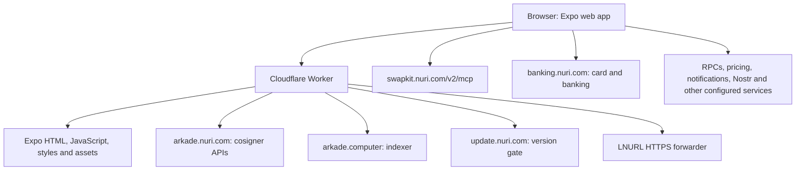

# How to inspect Nuri's web app

This guide maps the application at source commit
`1ef9850af9b05b2e58b8bd7054e3828c3c11a1a5` to its implementation and deployment.
It is not a security certification or a claim that every Nuri backend is included here.
See [publication readiness](open-source-readiness.md) for the dated release evidence,
cleanup performed, and work still required before public release.

## What this repository contains

- The Expo/React Native application, including its web-specific implementations,
  design system, local state, signing clients, and tests.
- The Cloudflare Worker serving the web export and forwarding selected API requests.
- The build configuration, dependency lockfile, package patches, and GitHub workflows.

It does **not** contain the complete running implementations of the cosigner,
SwapKit backend, banking backend, notifications backend, or external providers.
A working frontend build is not a self-hosted replacement for those services.
Public source URLs and versioned API contracts for those backends remain a separate
publication task; a link to an inaccessible repository is not public evidence.

## Start here in the code

| Question | Implementation |
| --- | --- |
| What runs first? | [`index.js`](../index.js): platform polyfills, log buffer, web chunk loader, API proxy, then `App` |
| How does the app choose what to display? | [`App.tsx`](../App.tsx): authentication, home screen, overlays, deep links, background work |
| Where is the main interface? | [`screens/home/UnifiedHomeScreen.tsx`](../screens/home/UnifiedHomeScreen.tsx), [`screens/home/MoveSheet.tsx`](../screens/home/MoveSheet.tsx) |
| Where does styling come from? | [`ds/nuri/index.ts`](../ds/nuri/index.ts), shared [`components/`](../components/), and [`assets/`](../assets/) |
| How are passkeys and wallet keys handled? | [`services/auth/`](../services/auth/), [`lib/walletDerivation.ts`](../lib/walletDerivation.ts), [`lib/secureKeyStorage.ts`](../lib/secureKeyStorage.ts) |
| How does platform behavior differ? | [`metro.config.js`](../metro.config.js), `*.web.ts` implementations, [`lib/web/ReactNativeKeychainWeb.ts`](../lib/web/ReactNativeKeychainWeb.ts) |
| Where are network choices made? | [`config/network.ts`](../config/network.ts), [`config/endpoints.ts`](../config/endpoints.ts), [`config/passkey.ts`](../config/passkey.ts) |

Do not infer web security from the native keychain implementation. Metro replaces
`react-native-keychain` with a browser implementation on web. The browser, its origin,
and the code delivered to that origin are part of the wallet's trust boundary.

## Follow the money and data



This is an application-boundary diagram, not an exhaustive list of network hosts.
Inspect [`public/index.html`](../public/index.html) for the Content Security Policy,
then inspect each service's configured endpoints. An allowed CSP host is not proof
that a request to it occurs, or proof of what data the request contains.

### Login and signing

Passkey ceremonies and wallet bootstrap live in `services/auth/`. The PRF-derived
wallet identity depends on the original RP ID and derivation inputs. Do not change
those values as part of a cleanup or a self-hosting experiment. A different origin
cannot simply use the production `nuri.com` credentials.

Bitcoin/Arkade signing is implemented in `services/bitcoin/` and `services/arkade/`.
The supported current cosigner is `arkade.nuri.com`; the legacy cosigner is not a
fallback. `npm run check:cosigner-boundary` enforces the application's boundary.
EVM transfers and card/banking operations have different trust models; the Bitcoin
cosigner model must not be used as a blanket claim for every asset or provider.

### New swaps use SwapKit v2

The current public-facing application entrypoints use `/v2/mcp`, not the legacy
`swap_execute`/`swap_track` flow described in older documents.

1. [`SwapContract.ts`](../services/swapkit/SwapContract.ts) and the v2 flow services
   select supported routes and obtain quotes.
2. [`SwapKitV2CommitFlow.ts`](../services/swapkit/SwapKitV2CommitFlow.ts) persists an
   accepted intent and its recovery key before committing the order. It connects
   the returned order to durable tracking.
3. [`SwapKitV2ActionService.ts`](../services/swapkit/SwapKitV2ActionService.ts)
   validates action requests, calls wallet executors, journals results, and submits
   evidence. Read the executor and flow-specific bounds too; a dispatcher is not
   the complete signing policy.
4. [`SwapKitV2PendingTracker.ts`](../services/swapkit/SwapKitV2PendingTracker.ts)
   and [`SwapKitV2OrderStore.ts`](../services/swapkit/SwapKitV2OrderStore.ts) manage
   continuation and stored order state. `App.tsx` starts v2 resumption.

The older `SwapKitService.ts` still exists. Some helpers, debug paths and tests
reference legacy modules. A file being named "v1" does not establish that every
export is dead. The existing production-boundary test checks that the application
entrypoint does not reach the v1 network transport; it also has a positive control.
Do not delete recovery or signing helpers merely because new orders use v2.

### Web delivery has more than one JavaScript file

[`lib/web/metroAsyncRequire.ts`](../lib/web/metroAsyncRequire.ts) installs a loader
for dependency-generated JavaScript chunks. Application-level dynamic imports are
restricted, but that does not make the entire web export a single-file artifact.
A complete release verifier must cover all emitted chunks, not just `index-*.js`.

[`public/nuri-service-worker.js`](../public/nuri-service-worker.js) handles push
notifications. This version has no fetch handler or offline asset cache. It is still
executable code that must be included in any release integrity manifest.

The Worker in [`cloudflare/src/worker.js`](../cloudflare/src/worker.js) serves static
assets, applies response headers, handles selected same-origin proxies, and limits
LNURL forwarding. Static file hashes do not verify the code actually executing at
the edge, backend responses, or dashboard-level Cloudflare configuration.

## Inspect and test without a funded wallet

Review the install scripts and [`patches/`](../patches/) before installing dependencies.
Use a disposable development environment without production credentials or wallets.
The dependency installation command used by the recorded deployment is:

```sh
npm ci --legacy-peer-deps
```

The following checks do not require a real wallet or intentionally exercise live services:

```sh
npm run check:cosigner-boundary
node scripts/check-no-dynamic-imports.mjs
node --test cloudflare/test/worker.test.mjs
VITEST_LIVE=0 npm test -- services/swapkit/SwapKitV2ProductionBoundary.test.ts services/swapkit/SwapKitV2NoV1Entrypoint.test.ts lib/web/metroAsyncRequire.test.ts public/nuriServiceWorker.test.ts
```

The deployment workflow also runs `npm run check`. Live tests and recovery scripts
are not an onboarding shortcut: some require real services, identities, or signing.
Starting the web application is not an offline demo; the default configuration points
to mainnet services. Do not import a funded wallet to inspect the UI.

## What is proved today, and what is not

The recorded deployment workflow associates a source commit with a main JavaScript
bundle hash. It checks the manifest, the homepage's bundle reference, and the served
bundle bytes after deployment. That is useful operator evidence, but not yet a
complete independent proof of source-to-browser equivalence.

The intended public release chain is:

1. Publish the exact source, lockfile, build tooling, and public build inputs.
2. Demonstrate byte-identical application artifacts from two clean builds.
3. Publish that complete artifact set, checksums, and verifiable build provenance.
4. Deploy the same artifacts without rebuilding them, and record the Worker version.
5. Let an independently obtained verifier compare received files with that release.

Development can remain in a private repository. For every production release, a
reviewed export must include all source and public inputs needed to reproduce the
application. Record the private development commit and public source commit as
separate identities. Build the public commit and deploy those exact artifacts; do
not rebuild from the private tree or publish an approximate mirror afterward.
Production deployment should require the matching public release and its evidence,
not depend on a periodic manual synchronization. This is the target process, not
functionality implemented by the current workflow.

Deployment timestamps and other variable metadata need a separately specified
provenance policy; they must not make the application payload nondeterministic or
be silently ignored by a verifier. Cloudflare response headers and transformations
also need a documented verification boundary.

A successful independent check can establish that the files it received match a
particular published release. It cannot prove that a server never serves different
files to another user, that a previously opened browser tab is running the checked
release, or that private backend implementations match their source. A check loaded
only from the app being checked is not an independent trust anchor. An attestation
proves recorded build provenance, not that source code is safe or all builds are
reproducible.

### File-integrity CLI

[`scripts/web-integrity.mjs`](../scripts/web-integrity.mjs) is a dependency-free
Node.js tool. It creates a sorted inventory of every regular file, recording byte
length and SHA-256. Local verification rejects missing, extra and changed files.
URL verification requests every listed file and checks the actual `/` homepage
against `index.html` too. It refuses redirects, unsafe paths and oversized bodies.
It compares decoded response bodies, so transport compression does not change the
expected hash.

After an approved build, the release pipeline can run:

```sh
# SOURCE_SHA must identify the source actually used for this asset build.
# The manifest must be outside the asset directory and must not already exist.
node scripts/web-integrity.mjs create cloudflare/assets /tmp/pwa-integrity.json "$SOURCE_SHA"
node scripts/web-integrity.mjs verify /tmp/pwa-integrity.json cloudflare/assets
```

A reviewer who has independently authenticated the release manifest can run:

```sh
node scripts/web-integrity.mjs verify-url /path/to/trusted-pwa-integrity.json https://app.nuri.com
```

The current deployment does not publish this manifest yet. These commands are not
a claim that the recorded release has already been verified with the new tool.
A manifest's `source_sha` is a label supplied by its producer; the tool does not
prove that the files were built from that commit. A trusted manifest must come
from a reviewed release/provenance process, not solely from the website under test.
The checker only compares listed files; HTTP does not reveal all extra routes or
code a server might selectively serve. It does not execute the app, inspect an
existing browser session, authenticate attestations, or verify server-side code.
Run `npm run test:web-integrity` for offline regression tests; they are also part
of `npm run check`.

Older security notes, including [`SECURITY-STATUS.md`](SECURITY-STATUS.md), retain their
original review dates. They must be revalidated before being presented as the security
status of this release. Do not remove a documented risk just to make publication look
cleaner.

## Using Empryo or another coding agent

Use the [independent AI review prompt](ai-review-prompt.md) to ask questions about
release integrity, keys, data access, money movement and remaining risks.

No particular agent is needed to build or verify Nuri. An agent can use the source
map above to explain a flow with file references and run the offline checks in an
isolated checkout. Do not provide real wallet material, support exports, production
credentials, or an unreviewed private Git history. Model-provider data handling and
the agent's own telemetry remain separate decisions. An agent's review is not a
release attestation, reproducible build, or security audit.
